# VitureBD

**braindance** puts the Linux desktop on VITURE Luma Ultra XR glasses: as a
plain monitor, as a screen anchored in your room by the glasses' head
tracking, or in live 3D, where every frame of the desktop gets a depth
estimate and a view for each eye. It also plays 3D videos, and shows 3D
models and Gaussian splat captures standing in the room. One program owns
the glasses for the whole session: it lights them as the only display,
switches their resolution, refresh rate and 2D/3D mode itself, and puts your
displays back when you're done. It runs on a laptop GPU (RTX 3060 Laptop,
6 GB).

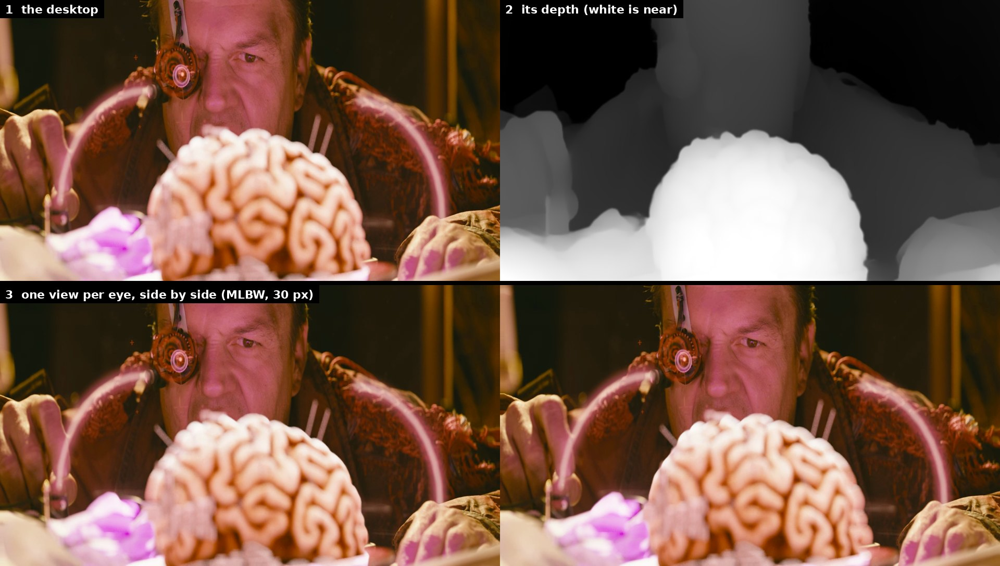

## What it does

- **Live 3D desktop.** Ordinary windows, videos and games appear with depth.
  Depth Anything V2 estimates each frame's depth, and a learned warp (MLBW) or
  a mesh warp turns it into a view per eye, at 60 fps.
- **The desktop in space.** In the 2D modes, up to 120 Hz, the desktop becomes
  a screen placed in front of you, flat or curved. It stays where you put it
  while you look around (ANCHOR) or glides after your head (FOLLOW), from
  3DOF or 6DOF head tracking.
- **3D videos.** Side-by-side and top-bottom files, played with libmpv, with
  their own controls drawn in both eyes.
- **3D models and splats.** glTF and GLB models with PBR materials, VRM
  avatars with their toon shader (MToon), and 3D Gaussian splat captures,
  standing in the room in stereo. With 6DOF you walk around them and lean in.
- **A panel inside the glasses**, worked with the mouse alone, so the
  keyboard stays with your windows.

On the glasses' OLED panels black is clear, so everything braindance doesn't
draw, around a placed screen or a model, is see-through.

## How it works

### The session

[`session.py`](braindance/session.py) owns the glasses and the X outputs from
start to exit. It refuses to start without the glasses. It saves the current
display layout (under `$XDG_RUNTIME_DIR`, so `braindance restore` can put it
back after a crash), lights the glasses as the only output, and restores the
layout when the session ends or the glasses are unplugged.

Display modes switch through VITURE's SDK. The glasses take a mode change
only while X is driving them in their current mode, so the session takes the
3D view down, switches, waits for the glasses to come back on DisplayPort,
and puts the view up again. It follows the glasses' own 2D/3D button too.

While it runs, braindance publishes a RandR monitor named `braindance` over
the desktop it shows: the whole panel in 2D, one eye in 3D. Window managers
and panels that manage outputs should defer to it. The qtile configuration
this was built with lays its screen out inside it.

### The glasses: SDK helper and head pose

The SDK runs in a helper process ([`glasses/`](braindance/glasses/)): its
teardown can hang, and a process can be killed where a thread can't. The
session talks to it in JSON lines (set and read the display mode, start and
stop the pose stream).

The Luma Ultra tracks the head in 3DOF (rotation, from its IMU) or 6DOF
(position too, from its cameras, with visual-inertial odometry running on
this machine). The SDK fixes the choice when it starts, so switching reopens
the session. For head tracking the helper polls the SDK's predicted pose
about 1000 times a second into a small shared-memory block guarded by a
sequence count ([`glasses/pose.py`](braindance/glasses/pose.py)); each frame
reads the newest sample just before it is drawn.

### What the glasses show

| Mode | What draws the picture |
|---|---|
| 2D, SPACE MODE off | X drives the glasses directly, like any monitor: no copy, no delay |
| 2D, SPACE MODE on | [`space.py`](braindance/space.py): the desktop as a screen placed by head tracking |
| 3D | [`desktop.py`](braindance/desktop.py): the live desktop, flat or in live 3D |
| over 3D | [`media.py`](braindance/media.py) (a video) or [`viewer.py`](braindance/viewer.py) (a model or splats); the live desktop pauses |

### Capture and presentation

Whenever braindance draws the desktop itself, X keeps rendering every window
into its own buffer but never to the screen (Composite, manual redirect). A
small C++ library ([`capture/`](capture/)) hands those buffers to the Python
renderer as GPU textures (GLX texture_from_pixmap), so nothing is copied and
nothing captures itself. braindance's window sits inside the composite overlay
window, above everything, and lets input through to the desktop. It hides the
hardware cursor and draws its own, in both eyes; in 3D, pointer barriers keep
the pointer on the one-eye desktop.

### Live 3D: depth and stereo

1. **Depth.** Depth Anything V2 Small runs as a TensorRT FP16 engine (6.6 ms
   at 392 × 686, or 29 ms for the sharper 700 × 1232 variant). Frames reach it
   and the depth leaves it through CUDA–OpenGL interop, never through the CPU.
   The depth is held steady: the depth range is smoothed across frames (as
   iw3 does), each pixel's depth is smoothed in proportion to how still its
   colour is, and edge dilation pulls the depth edges of near things in. Once
   the desktop holds still and its depth has settled, the model stops running.
   With SYNC off the depth runs on a worker thread and the display reuses the
   latest; with it on, each frame waits for its own depth.
2. **Stereo, MLBW.** iw3's learned backward warp (`mlbw_l2`, a TensorRT
   engine) predicts from the depth two sampling offsets and blend weights per
   pixel for each eye; a fragment shader blends the desktop at those offsets
   at full resolution. There are no holes to fill.
3. **Stereo, MESH.** A grid of 1024 cells across is displaced by the depth
   and drawn for each eye, with a depth test so the nearer surface wins where
   the warp folds. Where a near object's edge moves off the background, the
   mesh stretches the edge across the strip it uncovers. EDGE FILL finds those
   runs (a run is an edge when it is wider on screen than the desktop pixels
   it shows) and replaces them: MIRROR mirrors the background beside them in,
   NETWORK has iw3's inpainting network (`light_inpaint_v1`, a TensorRT engine
   run on both eyes at once) paint them. Depth edges can also be refined at
   full resolution, by joint bilateral upsampling or a guided filter.

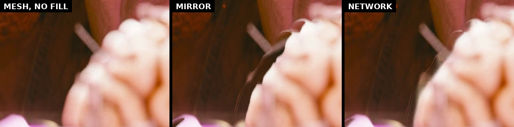

### The desktop in space

[`tracking.py`](braindance/tracking.py) turns the head pose into where the
screen sits; [`space.py`](braindance/space.py) composites the desktop into a
texture and draws it there, as one picture for both eyes at the mode's full
rate. The projection uses the display frustum from the glasses' factory
calibration (43° × 25°), so an anchored screen turns by exactly as much as
your head does.

- **ANCHOR**: the screen stays where it was placed, square to your view as it
  was then (it takes your head's roll too, so it lines up with the display
  however the glasses sit). A one-euro filter holds the head pose still
  against sensor noise, so text doesn't shimmer, and lets real motion through.
- **FOLLOW**: the screen glides after your head, however slowly it moves, and
  settles in front of you when you stop.
- **CURVE** bends the screen around you, every column the same distance from
  your eyes. At SIZE 100%, flat, a desktop pixel spans exactly one display
  pixel when the screen is straight ahead.

The desktop's size is kept apart from the display's, so a desktop larger than
the view can be placed the same way.

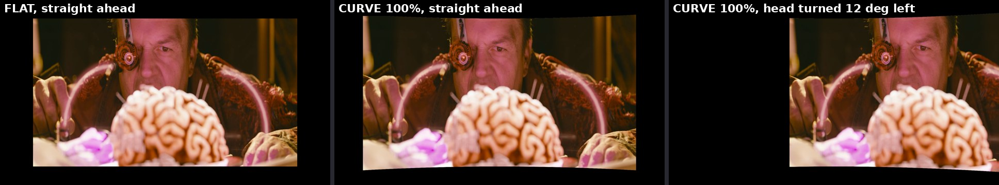

### The viewer: models and splats

[`viewer.py`](braindance/viewer.py) draws a model or a splat scene in stereo,
one view per eye 63 mm apart, from the head pose read just before each frame,
placed upright in front of you (ANCHOR) or gliding after your head (FOLLOW).

- **glTF / GLB** ([`model.py`](braindance/model.py)): trimesh reads the file;
  materials follow glTF's metallic-roughness model (base colour, metallic and
  roughness, normal maps, emission, occlusion, cut-out and blended
  transparency) under three lights fixed in the room, with ACES tone mapping
  and 4× multisampling.
- **VRM 0.x** avatars are drawn with their own toon shader, MToon, read from
  the file's VRM extension: the hard light-to-shade ramp with each material's
  shade colour, ambient, rim light, matcap, emission, and outlines drawn as the
  mesh's back faces pushed out along its normals.
- **Gaussian splats** ([`splats.py`](braindance/splats.py), `.splat` or a 3DGS
  `.ply`): each Gaussian is projected to an ellipse for each eye and blended
  back to front. The depth order is sorted on the GPU every frame and written
  straight into a GL buffer through CUDA–OpenGL interop. A capture is drawn
  whole, its surroundings included, but it is centred on and sized by its
  dense cluster: the subject, not the room.

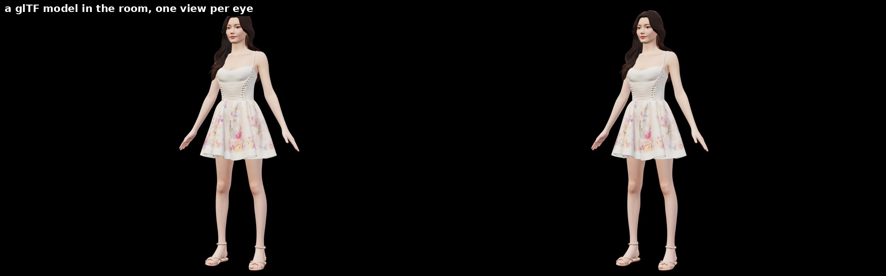

### Input and the panel

braindance never reads the keyboard outside a video or a model: it stays with
your windows and your window manager. The mouse's forward side button opens
the settings panel, drawn inside the glasses, floating in front of the scene;
while it is open the mouse is braindance's alone. The back side button
recenters the placed screen or model. Only the bare buttons are braindance's:
with Super held they stay the window manager's.

## Layout

| Path | What's in it |
|---|---|
| [`braindance/session.py`](braindance/session.py) | The session: displays, modes, views, apps, input, IPC |
| [`braindance/glasses/`](braindance/glasses/) | The SDK binding, its helper process, the display modes, the head pose stream |
| [`braindance/displays.py`](braindance/displays.py) | X outputs through RandR: snapshot, light alone, restore, the `braindance` monitor |
| [`braindance/desktop.py`](braindance/desktop.py), [`render.py`](braindance/render.py) | The live 3D desktop: capture, compositing, the warps, the edge fill |
| [`braindance/depth.py`](braindance/depth.py) | The depth pipeline: backends, stabilizer, dilation |
| [`braindance/stereo.py`](braindance/stereo.py), [`inpaint.py`](braindance/inpaint.py) | iw3's MLBW and inpainting networks, their engines |
| [`braindance/space.py`](braindance/space.py), [`tracking.py`](braindance/tracking.py) | The desktop placed in space |
| [`braindance/viewer.py`](braindance/viewer.py), [`model.py`](braindance/model.py), [`splats.py`](braindance/splats.py) | The model and splat viewer |
| [`braindance/media.py`](braindance/media.py) | The 3D video player |
| [`braindance/panel.py`](braindance/panel.py), [`menu.py`](braindance/menu.py), [`settings.py`](braindance/settings.py), [`input.py`](braindance/input.py) | The panel, its menu over the settings, the mouse |
| [`braindance/engines.py`](braindance/engines.py), [`registry.py`](braindance/registry.py) | Building the TensorRT engines |
| [`capture/`](capture/) | The C++ window-capture library (`libdesktopcapture.so`) |
| [`docs/`](docs/) | The README's images, and the script that renders the panel's |
| [`samples/`](samples/) | A model to try |
| `models/` | Built models: weights, ONNX and TensorRT engines (created by `braindance-build-engine`, not in git) |

## Requirements

- Linux on Xorg (X11), an NVIDIA GPU with CUDA and TensorRT
- VITURE Luma Ultra glasses
- VITURE's XR Glasses SDK for Linux x86_64 (2.4 or later), unzipped into
  `viture-sdk/` at the repo root (or set `BRAINDANCE_VITURE_SDK`). braindance
  switches display modes and reads head tracking through it. The SDK is
  copyright VITURE Inc. and not redistributable, so it is not in this
  repository.
- libmpv, for 3D videos
- [uv](https://docs.astral.sh/uv/), which installs Python 3.12 and the locked
  dependencies from `uv.lock`

## Setup

```bash
uv sync                                                # Python and dependencies
cmake -S capture -B capture/build && cmake --build capture/build -j
uv run braindance-build-engine da2-small               # depth engine (minutes)
uv run braindance-build-engine mlbw                    # stereo warp engines (minutes)
uv run braindance-build-engine inpaint                 # inpainting engine, for MESH (minutes)
```

Engines are specific to the GPU and the TensorRT version, so rebuild them
after changing either.

## Running

```bash
uv run braindance                    # start a session on the glasses
uv run braindance play movie.mkv     # play a 3D video
uv run braindance view model.glb     # view a model (.glb, .gltf, .vrm) or splats (.splat, .ply)
uv run braindance mode 3d-1200p90    # switch the glasses to another mode
uv run braindance modes              # the modes braindance drives
uv run braindance status             # what the session is driving
uv run braindance quit               # end the session and restore the displays
uv run braindance restore            # put the displays back after a crash
```

`play` and `view` open the file in the running session, or start one. From a
2D mode they switch the glasses to 3D for it, and back when you close it:
`view` to the fastest 3D mode, `3d-1200p90`. Try
`uv run braindance view samples/floral_woman.glb`.

The modes: 2D at 1920 × 1080 (60, 90, 120 Hz) and 1920 × 1200 (60, 90 Hz);
3D side by side at 1920 × 1080 per eye (60 Hz) and 1920 × 1200 (60, 90 Hz).

## Controls

The settings panel, opened with the mouse's forward side button:

| Where | Input | Action |
|---|---|---|
| on a setting | hover | Select it |
| | wheel | Step it up or down |
| | left click | Toggle it, cycle it, or apply it (OUTPUT, RECENTER, END SESSION) |
| | right click | Step it back |
| on a tab | click or wheel | Switch tabs |
| anywhere else on the panel | left drag | Move the panel (its place is kept) |
| beside the panel, live 3D desktop | wheel / left drag / middle click | Zoom / pan / reset |
| beside the panel, desktop in space | wheel / left drag / middle click | Size / move an anchored screen / recenter |

A model or splats:

| Input | Action |
|---|---|
| left or middle drag, **←** / **→** / **↑** / **↓** | Turn it (arrows by 15 degrees) |
| **Shift** + middle drag | Move it left, right, up and down, with the pointer (as in Blender) |
| wheel, **-** / **=** | Size |
| back side button, middle click, **R** | Recenter: place it in front of you again |
| **0** | Undo the turn, move and size |
| **Q**, **Esc**, **Backspace** | Close |

A video:

| Input | Action |
|---|---|
| **Space**, **K**, left click | Pause or play |
| **←** / **→** | Seek 5 s (Shift: 30 s) |
| **PgUp** / **PgDn**, **Home** | Seek 5 minutes; back to the start |
| **↑** / **↓**, wheel | Volume |
| **[** / **]** | Eye alignment: the picture farther or nearer (Shift: faster) |
| **-** / **=** | Picture size |
| **0** | Reset alignment and size |
| **M**, **S**, **A** | Layout, swap eyes, audio track |
| click the progress bar | Seek there |
| **Q**, **Esc**, **Backspace** | Stop |

Video layouts (full and half side-by-side, top-bottom) are told apart by the
file name, using iw3's tags and the common `SBS` / `HSBS` / `Full SBS` ones,
else by the frame's shape. To make braindance the program a file manager opens
3D videos with, install [`share/braindance-play.desktop`](share/braindance-play.desktop).

## The settings panel

Every setting applies on the next frame, so you can watch it change, and
persists to `config/state.json`, as does where you left the panel. Each tab
shows where it means something: GLASSES always, SPACE in the 2D modes, the
live desktop's tabs in 3D (EDGES and REFINE with the MESH warp), MODEL while a
model is open. The footer shows the frame rate, and how often the depth
refreshes (IDLE once it has settled) or the tracking state. The images are
rendered offscreen from the real menu by
[`docs/render_panel.py`](docs/render_panel.py).

| | | |
|---|---|---|
| 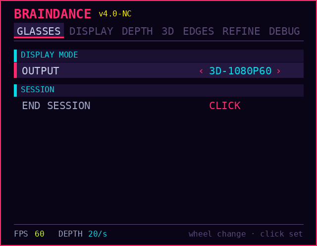 | 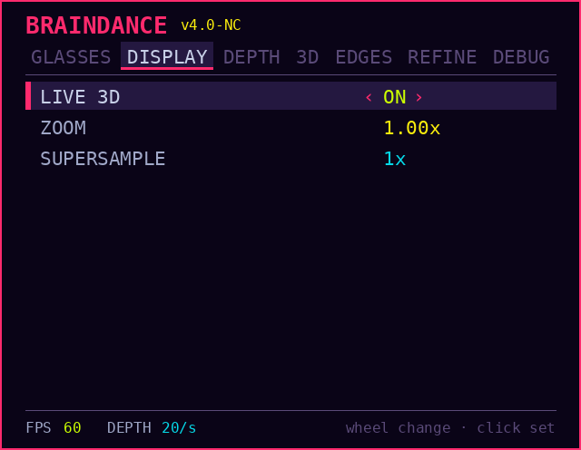 | 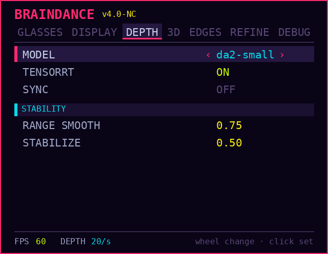 |
| 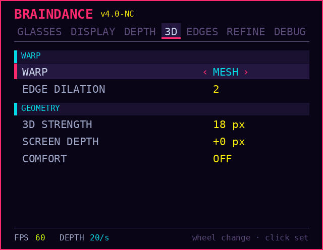 | 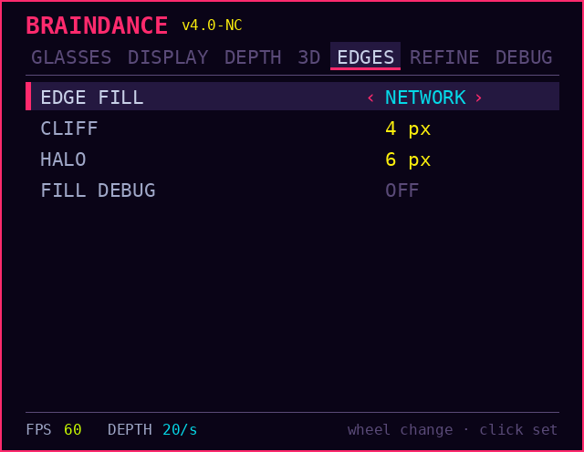 | 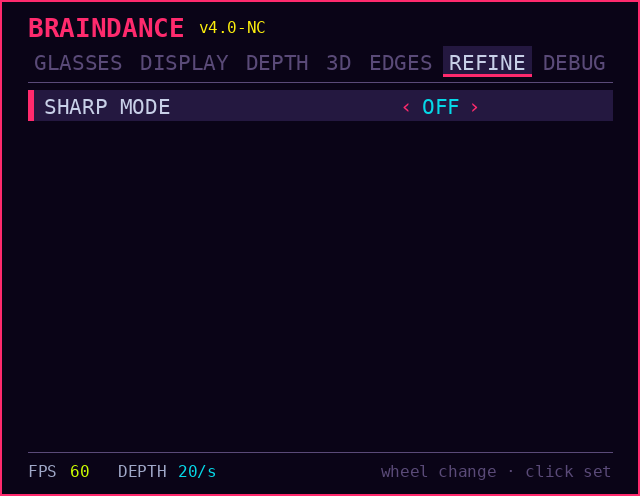 |
| 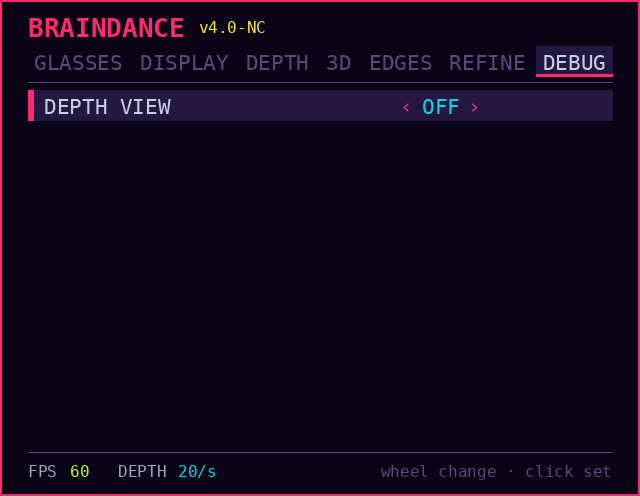 | 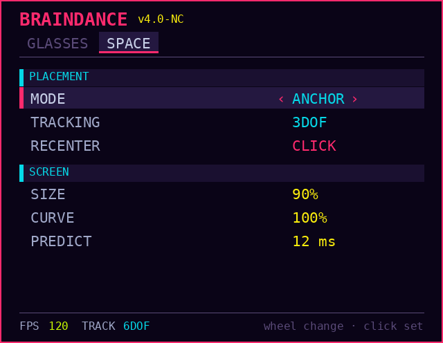 | 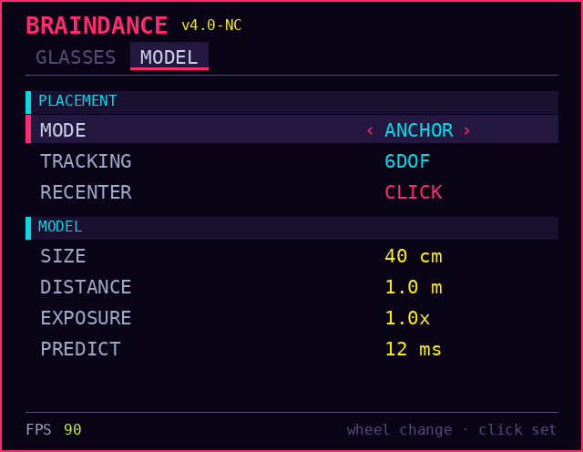 |

## Performance

Measured on an RTX 3060 Laptop (95 W):

| | |
|---|---|
| Live 3D desktop, SYNC off | 60 fps with any model and warp; depth refreshes 20–30 times a second |
| SYNC on, da2-small, MESH, EDGE FILL = MIRROR | 60 fps: 11–14 ms a frame |
| SYNC on, da2-small, MESH, EDGE FILL = NETWORK | 30 fps: 27 ms a frame (30 at p95) where there are edges to fill |
| SYNC on, da2-small, MLBW | 30 fps: 18 ms a frame |
| The desktop in space | 120 fps in `2d-1080p120` |
| A glTF model, both eyes | 1.4 ms a frame |
| Splats: a 65k face scan / 900k filling the view | 7 ms / 31 ms a frame |

## Status and credits

Built for my own glasses and driver setup, and not packaged for anyone else.
`braindance modes` leaves out 1920 × 1200 at 120 Hz: my Luma Ultra (firmware
12.0.02.002) accepts that mode but never comes up in it.

- [Depth Anything V2](https://github.com/DepthAnything/Depth-Anything-V2) Small
  (Apache 2.0) estimates the depth.
- The stereo warp network in [`stereo.py`](braindance/stereo.py) is iw3's
  `mlbw_l2`, and the inpainting network in [`inpaint.py`](braindance/inpaint.py)
  is iw3's `light_inpaint_v1`, from [nunif](https://github.com/nagadomi/nunif)
  by nagadomi (MIT); their weights are nunif's.
- The VRM toon shading follows MToon by Masataka Sumi (MIT), as V-Sekai's
  Godot-MToon-Shader ports it.
- The splats are drawn as in Kerbl et al.'s 3D Gaussian Splatting (2023), the
  way antimatter15's and gsplat.js's WebGL renderers draw them.
- The sample model, "[Beautiful Young Woman Wearing a floral Dress](https://sketchfab.com/3d-models/beautiful-young-woman-wearing-a-floral-dress-63a4f41ef8b4493aa1296bd1adbc03ee)"
  by [florah](https://sketchfab.com/florahhs), is under
  [CC BY-NC 4.0](http://creativecommons.org/licenses/by-nc/4.0/).
- The frame in the figures is from *Tears of Steel* (CC BY 3.0, © Blender
  Foundation, [mango.blender.org](https://mango.blender.org)).
