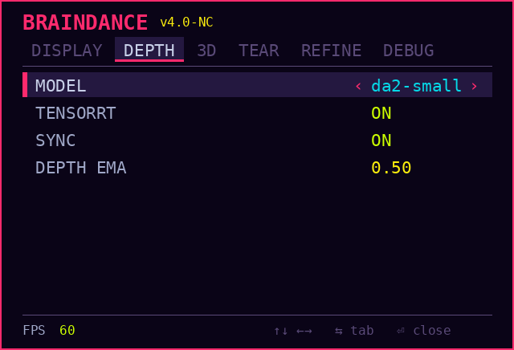

# VitureBD

Live 2D to 3D for the whole Linux desktop on VITURE Luma Ultra XR glasses.
Every frame of the desktop gets a depth estimate, and the image is warped into
a separate view for each eye, so ordinary windows, videos and games appear
with depth. It holds a steady 60 fps on a laptop GPU (RTX 3060 Laptop, 6 GB).

## How it works

1. **Capture.** A small C++ library captures the desktop window by window as
   GPU textures (XComposite and GLX texture_from_pixmap) and hands them to
   the Python renderer without copying. Capturing window pixmaps instead of
   the screen means the overlay never captures itself.
2. **Depth.** Depth Anything V2 Small, built into a TensorRT FP16 engine
   (about 120 fps, against about 67 fps in PyTorch), with CUDA-OpenGL interop
   so frames never round-trip through the CPU.
3. **Stereo.** A GLSL mesh warp shifts every pixel by its depth to make the two
   eye views, tears the mesh at depth edges so foreground objects separate from
   the background, fills the holes this opens, and refines the edges at full
   output resolution.
4. **Presentation.** The stereo pair goes side by side to the glasses. The
   desktop itself is rendered on a separate display head, so a fullscreen
   window can never cover the overlay.

Everything is tuned live from a settings panel drawn inside the glasses:

## Layout

| Folder | What's in it |
|---|---|
| [`wreath/braindance/`](wreath/braindance/) | The 2D-to-3D desktop itself: capture library, depth backends, renderer, settings panel. Start here. |
| [`wreath/kiroshi/`](wreath/kiroshi/) | An earlier head-tracked 6DoF virtual desktop. Only my own capture code is here; the VITURE demo it extends is not included. |

## Requirements

- Linux on Xorg (X11), an NVIDIA GPU with CUDA and TensorRT
- VITURE Luma Ultra glasses in 3D side-by-side mode
- Python 3.12 with the packages in `wreath/braindance/requirements.txt`

braindance only talks to the glasses as a display, so it does not need
VITURE's SDK. kiroshi does, and the SDK is copyright VITURE Inc. and not
redistributable, so neither the SDK nor its demo is in this repository.

## Status

Built for my own glasses and driver setup, and not packaged for anyone else.
The braindance README predates some of the work: TensorRT and the per-eye
cursor described there as to-dos are both implemented.
